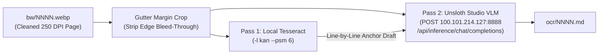

# Implementation Plan: Kannada OCR (`ocr_pages.py` $\rightarrow$ `ocr/NNNN.md`)

## Goal Description
Create a standalone script [ocr_pages.py](file:///Users/pradeep/files.btbytes.com/kannada/kannada-bala-vyakarana/ocr_pages.py) that converts each cleaned page image (`bw/0001.webp` … `bw/0116.webp`) into accurate Kannada Markdown (`ocr/0001.md` … `ocr/0116.md`) using **`unsloth/Qwen2.5-VL-32B-Instruct-GGUF`** on your **RTX 5090 Unsloth Studio** server (`http://100.101.214.127:8888`) combined with a local **Tesseract (`-l kan`)** line anchor.

---

## Verified Server Status (`100.101.214.127:8888`)

We verified connectivity and authentication with your API key (`sk-unsloth-...`) against `http://100.101.214.127:8888`:

> [!NOTE]
> **Cached Vision Models Currently on `100.101.214.127:8888`:**
> - `unsloth/Qwen2.5-VL-7B-Instruct-GGUF` (`BF16`, 16.5 GB) — **Already downloaded & ready**
> - `unsloth/Qwen3.8-27B-GGUF` (`UD-Q6_K_XL`, 26.2 GB, `has_vision: true`) — **Already downloaded & ready**
> - `unsloth/Qwen2.5-VL-32B-Instruct-GGUF` (`UD-Q4_K_XL`) — **Not yet downloaded in cache** (`downloaded: []`)
>
> `ocr_pages.py` will automatically check if `unsloth/Qwen2.5-VL-32B-Instruct-GGUF` is downloaded; if not, it can either auto-download `UD-Q4_K_XL` via `POST /api/hub/download` (and poll `/api/hub/download-status`) before calling `POST /api/inference/load`, or you can pass `--model unsloth/Qwen2.5-VL-7B-Instruct-GGUF` / `--model unsloth/Qwen3.8-27B-GGUF` to run immediately without waiting for a HuggingFace download.

---

## Architecture & Pipeline



---

## Proposed Changes

### Standalone Kannada OCR Script

#### [NEW] [ocr_pages.py](file:///Users/pradeep/files.btbytes.com/kannada/kannada-bala-vyakarana/ocr_pages.py)
- Standalone PEP 723 (`#!/usr/bin/env -S uv run --script`) Python script with dependencies `httpx` and `pillow`.
- **Model Management (`ensure_model_loaded`)**:
  1. Checks `GET /api/inference/status` to see if the target model is already active with vision enabled.
  2. Queries `GET /api/models/gguf-variants?repo_id=<model>` to pick the downloaded quant (or downloads `UD-Q4_K_XL` via `POST /api/hub/download` if `unsloth/Qwen2.5-VL-32B-Instruct-GGUF` is requested and not yet cached).
  3. Calls `POST /api/inference/load` with `{"model_path": repo_id, "gguf_variant": quant, "disable_vision": false}`.
- **Two-Pass Kannada OCR per Page**:
  1. Crops `2.5%` left/right scanner gutter bleed-through from `bw/NNNN.webp`.
  2. Runs local `tesseract stdin stdout -l kan --psm 6` to get a line-anchored draft.
  3. Sends the cropped image (`data:image/png;base64,...`) + Tesseract draft to `POST /api/inference/chat/completions` (`temperature: 0.1`, `max_tokens: 4096`).
  4. Cleans any outer markdown code fences or `<think>` blocks and writes `ocr/NNNN.md`.
- **CLI Options**:
  - `--host` (default: `http://100.101.214.127:8888`)
  - `--api-key` (default: `UNSLOTH_API_KEY` env var)
  - `--model` (default: `unsloth/Qwen2.5-VL-32B-Instruct-GGUF`)
  - `--quant` (optional quant override, e.g., `UD-Q4_K_XL` or `BF16`)
  - `--pages` (e.g., `10,15` or `1-10`) / `--max-pages`
  - `--no-tesseract` (pure VLM mode without Tesseract draft)
  - `--force` (overwrite existing `ocr/NNNN.md`)

---

## Verification Plan

1. **Ensure Model Ready & Run Sample Pages (`10` and `15`)**:
   ```bash
   UNSLOTH_API_KEY=sk-unsloth-61c2bfb196acc3087f858f9d0cfcc7ed ./ocr_pages.py --pages 10,15
   ```
2. **Verify `ocr/0010.md` and `ocr/0015.md`**:
   - Confirm accurate Kannada ottaksharas, grammar equations (`ಹೊಲ + ಉ = ಹೊಲವು (ವ್ + ಉ = ವು)`), and vargiya consonant tables (`ಕ—ವರ್ಗ` … `ಪ—ವರ್ಗ`).
3. **Run Full Book OCR (`ocr/0001.md` … `ocr/0116.md`)**:
   ```bash
   UNSLOTH_API_KEY=sk-unsloth-61c2bfb196acc3087f858f9d0cfcc7ed ./ocr_pages.py
   ```


